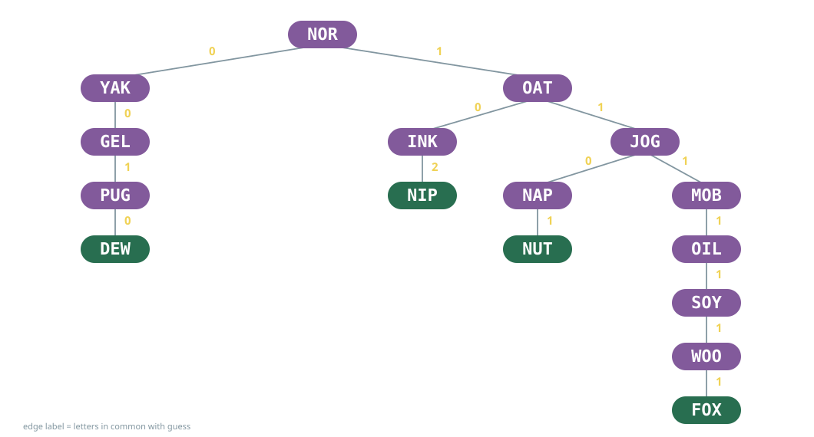
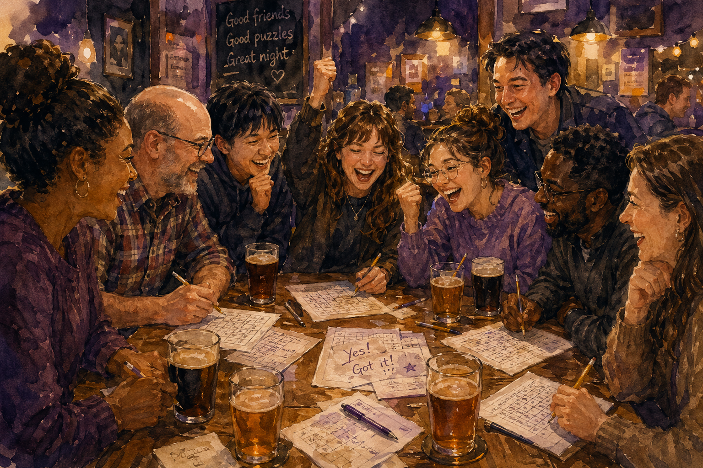
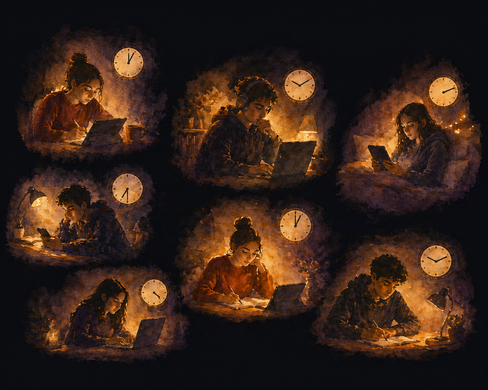

<!-- Pattern for every beat: an illustration or story, then ONE principle slide. No bullets, no reveals. -->

# [Part 1]{.slate style="font-size: 0.5em; display: block;"} [Joy in Community]{.yellow}

::: {.notes}
Up while people finish eating. Don't introduce it. Start Jotto.
:::

## Jotto

<pre style="font-size: 3rem; font-weight: bold; text-align: center; line-height: 2; letter-spacing: 0.05em; border: none; box-shadow: none; background: transparent;">
MOB    YAK    GEL    NIP
OAT    PUG    FOX    NOR
WOO    INK    SOY    JOG
NUT    DEW    NAP    OIL
</pre>

Pick one. Make sure everyone knows and agrees.

::: {.notes}
NO PREAMBLE. Start the slide. Say:

You're the Wordle master and I'm going to guess your word. Pick one of these, and make sure the whole room knows it and agrees. I'll leave the organizing to you. I'm stepping out. You have 45 seconds.

Come back in at the BACK of the room. They turn to look.

Getting a banquet hall to agree takes longer than a lecture room. That's fine. If it falls apart, give them 30 more seconds and say so out loud. Fallback: each table picks a word, and you choose one table at random.
:::

## My Jotto Algorithm

{fig-align="center" width="100%"}

::: {.notes}
Tell me *how many* letters my word has in common with yours. Play from the tree. First guess is NOR.

Walk to the front.

"That's a decision tree. Every one of you has built one. So: is this a good tree?"

This room will actually answer: depth, balance, information gain. Let one or two say it. Enjoy that they know.

"It's deliberately bad. I don't split well. You knew that in about three seconds."

Welcome. Who I am. How glad I am to see alums back.

The hinge: "Notice what you just did. Before I could run my algorithm, this whole room had to agree on one word, with no instructions and no leader. That part wasn't on the slide. Hold on to it."
:::

## How learning feels in a classroom...

{fig-align="center" height="550"}

::: {.notes}
Gesture back at the game. "That's what learning feels like when it's going well. Noisy. A little chaotic. Other people."

Pause. Advance.
:::

## Puzzled Pint

{fig-align="center" height="500"}

::: {.notes}
Puzzled Pint: a monthly puzzle night at a bar. Old friends, new friends, a former student, my kid's girlfriend. A very mixed group.

So common: one person sees it, and everyone else just KNOWS they're right. Nobody could have produced it alone, but the whole table recognizes it instantly.

For the alums: "You graduated. You didn't stop learning. So where does it happen now? I bet it happens somewhere like this: a table, people, a problem nobody can do alone."
:::

## How we think we learn best:

{fig-align="center" height="550"}

::: {.notes}
"And this is how a lot of us think we learn best. Each of us alone, at 3am, with something patient and tireless on the screen."

"Students: is this you? It's fine. My own kid looked at this and said 'this is very me coded.'"

"Alums, you have your own version: headphones on, asking the chatbot instead of the person two desks over. Or two Slack channels over."

"I want to talk about the gap between these two pictures. And I want to start by admitting that the second one has some good data on its side."
:::

## Harvard Physics, Fall 2023

::: {style="font-size: 0.8em; color: #8296a0; margin-bottom: 1em;"}
194 students &emsp;·&emsp; randomized crossover &emsp;·&emsp; AI tutor at home *vs.* active-learning class
:::

::: {.columns style="text-align: center;"}
::: {.column width="33%"}
[**2×**]{.yellow style="font-size: 3em; font-family: Quicksand;"}

learning gains
:::
::: {.column width="33%"}
[**49**]{.orange style="font-size: 3em; font-family: Quicksand;"}

minutes, vs. 60 in class
:::
::: {.column width="33%"}
[**↑**]{.purple style="font-size: 3em; font-family: Quicksand;"}

engagement & motivation
:::
:::

::: {style="font-size: 0.55em; color: #8296a0; text-align: right; margin-top: 2em;"}
Kestin et al. (2025), *Scientific Reports* 15:17458
:::

::: {.notes}
"I want to be fair to this study, because I think it's good work."

Harvard intro physics (PS2). Each student did one lesson with a custom AI tutor at home and one in an active-learning class, in consecutive weeks. Surface tension and fluid flow.

- Median post-test 4.5 (AI) vs 3.5 (class), from a pre-test of 2.75. Effect size 0.73–1.3 SD.
- Median 49 minutes vs a 60-minute class.
- Engagement 4.1 vs 3.6; motivation 3.4 vs 3.1 (5-point scales).

And the comparison wasn't a bad lecture. It was active learning, run by people who are very good at it.

"So if you've been quietly thinking 'I learn better on my own with the AI,' here's a paper that agrees with you. And if you're at work, your company probably agrees too: it just bought everyone a copilot."

Pause. Let them feel agreed with. DON'T strawman this; this audience will notice.

Bridge: "I believe it. What it measured was how much physics you could show on a test the next week. That's real. It just isn't all of what I mean by learning."
:::

##

::: {.principle}
[Learning is]{.yellow} [communication.]{.orange}
:::

::: {.cite}
Vygotsky (1978) &emsp;·&emsp; Sfard (2008) &emsp;·&emsp; Chi et al. (1994) &emsp;·&emsp; Chi & Wylie (2014)
:::

::: {.notes}
This is the centre of the talk. Slow down.

"Learning isn't a stock of facts. It's a process: your understanding grows, with no predetermined path, and it happens organically *between* people."

Vygotsky: every function appears twice, first between people, then inside one person. The conversation comes first.

Sfard: thinking *is* communicating, the conversation with yourself that you learned by having it with others.

Chi: you find out what you don't understand when you try to explain it. Chi & Wylie (ICAP): explaining *with* someone who doesn't just nod beats explaining alone.

"That's a claim. Let me show you instead."
:::

# [Part 2]{.slate style="font-size: 0.5em; display: block;"} [Everyone Holds a Piece]{.orange}

::: {.notes}
Straight into the cards.
:::

## A Slippery Puzzle {.class-demo}

A &nbsp; B &nbsp; C

Find a rule that applies to everyone's set of numbers.

::: {.notes}
Cards out, numbers side up.

"Ignore the picture, it's for something else. You've got three numbers. There's one rule that holds for every card in this room. Find it."

60–90 seconds. Tables will start talking to each other without being asked. Let them.

Hear two or three conjectures. Hand the tablet to someone to write the rule (A + B = C + 2 or similar). Don't confirm. "Now flip your card."
:::

## A Slippery Puzzle {.class-demo}

A: &emsp;&emsp;&emsp;&emsp;&emsp; B: &emsp;&emsp;&emsp;&emsp;&emsp; C: &emsp;&emsp;&emsp;&emsp;&emsp;

How do the numbers relate to the graph on the flip side?

::: {.notes}
"Which number is which? Check your neighbour's card. And the next table's."

Someone will undercount faces by one. BALLOON: hold up the graph drawn on it. On a sphere every region is enclosed, including the "outside."

Get vertices, edges, faces written on the tablet.
:::

## A Slippery Puzzle {.class-demo}

::: {style="text-align: center; margin-top: 1em;"}
*In any connected planar graph,*

$$V - E + F = 2$$

*where V is the number of vertices, E the number of edges, and F the number of faces.*
:::

::: {.notes}
"You couldn't have checked that alone. One card is one data point. Your neighbour's card was data you couldn't generate yourself. And the outer face? Someone at your table said it out loud before you saw it."

"The room was the instrument."
:::

##

::: {.principle}
[The critical information was]{.yellow} [spread out among you.]{.orange}
:::

::: {.cite}
Transactive memory: Wegner (1987)
:::

::: {.notes}
Wegner: transactive memory. Groups learn who knows what, and the group itself becomes the thinking system. That's exactly what the cards were. It's structurally impossible one-on-one.

"None of that shows up on a post-test about surface tension. All of it just happened at your table."
:::

##

::: {.principle}
[A machine gives]{.slate} [*the* answer.]{.slate}

[People give]{.orange} [responses.]{.yellow}
:::

::: {.notes}
"*The* answer arrives with the authority of the textbook, so you mostly just accept it. A response doesn't. It has to earn its credibility by being heard. That's why you have to listen carefully, and weigh it."

"And a response has nuance that can make the shared idea better. That's what got your table to the formula."

"Careful listening is a deeply human skill. Hold on to that; it comes back in Part 3."
:::

# [Part 3]{.slate style="font-size: 0.5em; display: block;"} [Diversity]{.purple}

::: {.notes}
"So everyone holds a piece. Here's the part I care about most: it matters *whose* pieces are in the room."
:::

## The colour cube {.class-demo}

<iframe src="rgb_cube.html"></iframe>

::: {.notes}
Spin it. Every colour a screen can show is a point in this cube.

Click "remove green." The cube collapses to one face. Purples.

"Here's what gets me. If you'd only ever lived on this face, you wouldn't think anything was missing. Purple would look like the whole world. You can't see a dimension you never had."

Click "add green back."
:::

## What do you notice?

::: {style="display: flex; justify-content: center; margin-top: 0.5em;"}
| Red | Green | Blue | |
|:---:|:-----:|:----:|:---:|
| 255 | 0 | 0 |  |
| 17 | 0 | 178 |  |
| 45 | 0 | 13 |  |
| 200 | 0 | 220 |  |
| 62 | 0 | 37 |  |
| 130 | 0 | 95 |  |
:::

::: {.notes}
Bring the physical RGB cube prop.

"What do you notice about these colours?" This room will spot the zero column in seconds. Let someone say it.

"No green. And look what you get: reds, purples, magentas. Every one of them is some kind of purple."

[Your CPSC 203 narrative goes here: the cube prop, missing dimensions.]
:::

## The colour cube {.class-demo}

<iframe src="rgb_cube.html"></iframe>

::: {.notes}
Spin it. Every colour a screen can show is a point in this cube.

Click "remove green." The cube collapses to one face. Purples.

"Here's what gets me. If you'd only ever lived on this face, you wouldn't think anything was missing. Purple would look like the whole world. You can't see a dimension you never had."

Click "add green back."
:::

##

::: {.principle}
[Leave out a dimension,]{.yellow}

[and you can't see]{.orange} [what's missing.]{.purple}
:::

::: {.notes}
Draw the parallel: ideas live in a space too. Explore only a few dimensions and you shrink what you can see, and you won't know you've done it.

Every person you actually listen to can add a dimension. A room with everyone's perspective in it can see colours nobody could see alone.

Tie back: *the* answer comes from the centre of what's already been written down. A response from a person can come from a direction you didn't know existed.

Know where the metaphor breaks: more people doesn't automatically mean more dimensions. A room of people who think alike all live on the same face of the cube. It's the *difference* between perspectives that adds the dimension.

This is a WiDS room. You don't have to say out loud whose dimensions have historically been left out of data science. They know.
:::

##

::: {.principle style="font-size: 1.2em;"}
[A group's intelligence isn't predicted by its smartest member.]{.yellow}

[It's predicted by how well its members]{.orange} [listen to each other.]{.green}
:::

::: {.cite}
Woolley, Chabris, Pentland, Hashmi & Malone (2010), *Science*
:::

::: {.notes}
"And there's data that ties all three together."

Woolley et al.: a single factor, c, predicts group performance across very different tasks. Average and maximum individual intelligence barely predict it.

The strongest predictor is social sensitivity: the careful listening from "*the* answer vs. a response."

Turn-taking: groups where a few voices dominate the conversation do worse. Diversity of voice only helps if the voices actually get heard.

And c rises with the proportion of women in the group, largely explained by social sensitivity. Let the WiDS room enjoy that one.
:::

<!-- SUMMARY + TRANSITION to the conclusion -->

## What happened tonight

::: {.columns style="text-align: center; margin-top: 1.2em;"}
::: {.column width="33%"}
[Jotto]{.slate style="font-size: 0.7em;"}

[**Negotiation & collaboration**]{.yellow style="font-family: Quicksand; font-size: 1.1em; display: block; min-height: 2.8em; line-height: 1.3;"}

[You agreed on one word, with no leader.]{style="font-size: 0.75em;"}
:::
::: {.column width="33%"}
[Euler's cards]{.slate style="font-size: 0.7em;"}

[**Distributed data**]{.orange style="font-family: Quicksand; font-size: 1.1em; display: block; min-height: 2.8em; line-height: 1.3;"}

[Nobody could find the rule from one card.]{style="font-size: 0.75em;"}
:::
::: {.column width="33%"}
[The colour cube]{.slate style="font-size: 0.7em;"}

[**Diversity**]{.purple style="font-family: Quicksand; font-size: 1.1em; display: block; min-height: 2.8em; line-height: 1.3;"}

[Leave out a dimension and you can't see what's missing.]{style="font-size: 0.75em;"}
:::
:::

::: {style="text-align: center; font-family: Quicksand; font-size: 1.2em; margin-top: 1.8em;"}
[Each of these stories is different if the concept is learned in isolation.]{.green}
:::

::: {.notes}
Slow down. This is the turn toward the end.

"Three things happened in this room tonight. You negotiated: a whole room agreed on one word, and nobody was in charge. You pooled distributed data: the rule wasn't on any one card. And you saw that it matters whose voices are in the room, because a missing dimension is invisible from the inside."

"None of those is something you can do with a tutor at 3am. And all three are exactly what the people in this room who are working do every day."

Then: "And there's data that ties all three together."
:::

## Alums: a quick poll

::: {.principle style="font-size: 1.2em; padding-top: 1em;"}
Was the hardest part of your job last month [**technical**]{.slate}?
:::

::: {style="text-align: center; margin-top: 1.5em;"}
Or was it...
:::

::: {style="width: 80%; margin: 1em auto 0; font-size: 0.8em; color: #8296a0; line-height: 1.8;"}
[figuring out the [**question**]{.yellow} someone was really asking?]{style="display: block; margin-left: 0;"}
[telling someone their data [**can't answer it**]{.orange}?]{style="display: block; margin-left: 12%;"}
[getting people to agree on what a [**column means**]{.purple}?]{style="display: block; margin-left: 24%;"}
:::

::: {.notes}
"Alums: raise your hand if the hardest part of your job last month was technical."

Some hands. Fewer than the students expect.

"Keep your hand up if the hard part was actually figuring out what question someone was asking. Or telling someone their data couldn't answer it. Or getting three teams to agree on what a column means."

Let the students look around the room.

"That's Jotto. A room full of people who have to agree on one thing before anybody's algorithm can run."

If there's an alum you know well, ask them beforehand for a one-sentence story and call on them by name.
:::

##

::: {.principle}
[Every workplace is a group project.]{.yellow}
:::

::: {.notes}
At WCCCE this line was "We're practicing." Half this room isn't practicing any more. They're in it, so the alums get to nod.

No tutor can pass that test. The question isn't sitting there waiting to be answered. It gets built, between people who each hold part of it.

Then the practical part, said rather than shown. Don't end anti-AI; this audience uses these tools every day, and so do I.

"So use the tutor. Seriously. Then bring what you learned somewhere: a room, a table, a study group, a code review, a stakeholder meeting."

"Students: you're someone else's data. When you're not in the room, everyone is a little less capable, including you."

"Alums: you're the community of practice these students are trying to join." (Lave & Wenger: novices move from the edge to the centre by working alongside people further in.) "And you're still learning, so protect the rooms where it happens at work: the whiteboard session, the code review, the question you were about to ask a chatbot instead of a colleague."
:::

<!-- CLOSING: the one and only use of "expertise" -->

## Redefining the goal...

::: {.principle style="font-size: 1.4em;"}
[Expertise isn't having *the* answer.]{.yellow}

[It's knowing how to nurture and elicit all the ideas, from every person.]{.orange}
:::

::: {.notes}
This is the only time the word appears in the talk. Don't villainize knowing things; redefine what it means to be good at something.

Think about what the alums said makes their jobs hard in the poll: finding the real question, delivering bad news about data, getting teams to agree. That's making the room smarter.

Let it breathe. No summary after this.

Thank you, enjoy the rest of the evening.
:::

## References {style="font-size: 0.45em;"}

Chi, M. T. H., de Leeuw, N., Chiu, M.-H., & LaVancher, C. (1994). Eliciting self-explanations improves understanding. *Cognitive Science*, 18(3), 439–477.

Chi, M. T. H., & Wylie, R. (2014). The ICAP framework: Linking cognitive engagement to active learning outcomes. *Educational Psychologist*, 49(4), 219–243.

Kestin, G., Miller, K., Klales, A., Milbourne, T., & Ponti, G. (2025). AI tutoring outperforms in-class active learning: an RCT introducing a novel research-based design in an authentic educational setting. *Scientific Reports*, 15, 17458.

Lave, J., & Wenger, E. (1991). *Situated Learning: Legitimate Peripheral Participation*. Cambridge University Press.

Sfard, A. (2008). *Thinking as Communicating: Human Development, the Growth of Discourses, and Mathematizing*. Cambridge University Press.

Vygotsky, L. S. (1978). *Mind in Society: The Development of Higher Psychological Processes*. Harvard University Press.

Wegner, D. M. (1987). Transactive memory: A contemporary analysis of the group mind. In B. Mullen & G. R. Goethals (Eds.), *Theories of Group Behavior* (pp. 185–208). Springer.

Woolley, A. W., Chabris, C. F., Pentland, A., Hashmi, N., & Malone, T. W. (2010). Evidence for a collective intelligence factor in the performance of human groups. *Science*, 330(6004), 686–688.
